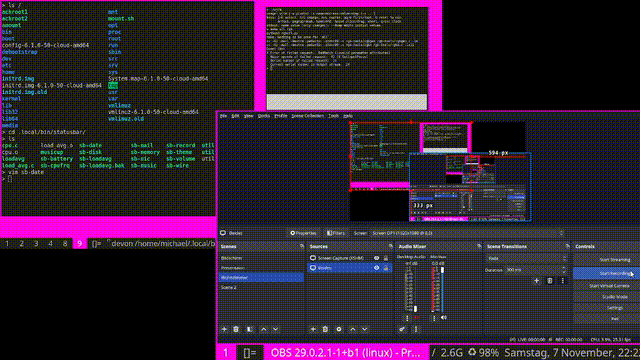

# suckless-mitnight-patches
rgb dmx support for dwm and dmenu. don't use it



# suckless RGB stream — X11 and DMX

`rgbgen` (C) generates `R G B\n` on stdout. `rgbx` (C/Xlib) consumes the same stream and writes `_SUCKLESS_RGB` on the X11 root as `#RRGGBB` (XA_STRING). dwm and dmenu read it on `PropertyNotify`. No threads, no additional server, no Xresources writes, no UI animation loop.

The stream is the **source of truth** for both screen and stage; every consumer receives the same samples. `rgbgen` is deterministic per `(mode, speed, fps, starting phase)` except real-time pacing.

## Build

```sh
cd rgb-tools && make
```

To compile dwm, install your usual `libxft-dev`, `libfontconfig-dev`, X11/Xinerama and XCB development dependencies, then run `make` in `dwm/`. This container lacks several of those libraries, so that build has not been verified here.

To patch stock dmenu 5.4, first apply `dmenu-globalzoom-5.4-v2.patch` from the parent folder, and **then** run `patch_dmenu_rgb.py`:

```sh
cd dmenu-5.4
patch -p1 < ../dmenu-globalzoom-5.4-v2.patch
python3 ../patch_dmenu_rgb.py dmenu.c
make
```

## Start and stop

```sh
./rgb-tools/rgbgen -m rainbow -s 0.15 -f 25 | ./rgb-tools/rgbx
./rgb-tools/rgbx -c   # delete property, restore original colors
```

RGB is temporarily persistent in the X server; after the producer stops, last frame remains until `rgbx -c` or X server restart. No speed-dependent state resides in dwm/dmenu. An optional cleanup trap can clear the property.

## DMX synchronization

The same RGB lines are reusable for DMX. Do not generate a separate independent rainbow for DMX; phase drift is inevitable. Your UNO daemon uses `/tmp/unodmx.sock`, but its specific accepted socket command format is not evidenced by the supplied files. Therefore this project includes `rgbdmx.py`, which accepts an explicitly configured socket message template. It does **not** assume a DMX socket protocol.

Example with a *hypothetical* daemon that accepts `set <channel> <value>\n`:

```sh
./rgb-tools/rgbgen -m rainbow -s 0.1 -f 25 | tee >(./rgb-tools/rgbx) | \
  ./rgb-tools/rgbdmx.py --socket /tmp/unodmx.sock --template 'set {ch} {value}\n' --start 1
```

Change `--template` to **your daemon's actual protocol**. The adapter writes three messages per frame, mapping red, green, blue to three consecutive DMX channels. Check your LED controller's mode and starting address; DMX channels are not necessarily 1/2/3. Running at 25 fps means potentially 75 DMX update commands/second. If your daemon requires atomic multi-channel frame updates, use `--frame-template` (placeholders `{r}`, `{g}`, `{b}`, `{start}`) according to its actual socket protocol; a single message is needed for an atomic RGB frame.

For deterministically identical sampled frames, prefer a named FIFO / dedicated multicasting pump rather than two independently launched generators. `tee` works for local pipes; if a consumer stalls, all outputs may block. This backpressure is intentional Unix stream behavior, not a real-time guarantee. If physical timing matters, run a dedicated nonblocking broadcast process and send timestamped frames.

## Xft/dwm behavior

The global accent affects the selected bar background, the focused window border, and a darker inactive border. Selected text uses a light or dark contrast color computed from the accent. The original Xresources baseline remains unchanged. The accent is transient and may be cleared without restarting dwm. RGB allocations are freed on replacement. Focusing new clients uses the current border scheme.

`Xft.dpi` affects font sizing and has no part in RGB updates. X11-property writes do not send per-frame keyboard actions.

## Live control (stdin)

`rgbgen` accepts `speed 0.5`, `mode pulse`, `mode rainbow`, `mode solid`, and `color 255 20 0` on stdin while streaming on stdout. For an interactive terminal, run the producer with stdin attached and pipe stdout to the consumers. To control remotely, use a dedicated FIFO kept open for writing, e.g. `mkfifo /tmp/rgbctl; tail -f /dev/null > /tmp/rgbctl &` is **not** necessary when a controller already holds the FIFO open. In a shell with `coproc`, the commands can be written to the generator's stdin.

The rate `-f` is fixed at startup (1..60 Hz); changes to `speed` adjust phase rate without resetting the current color.
